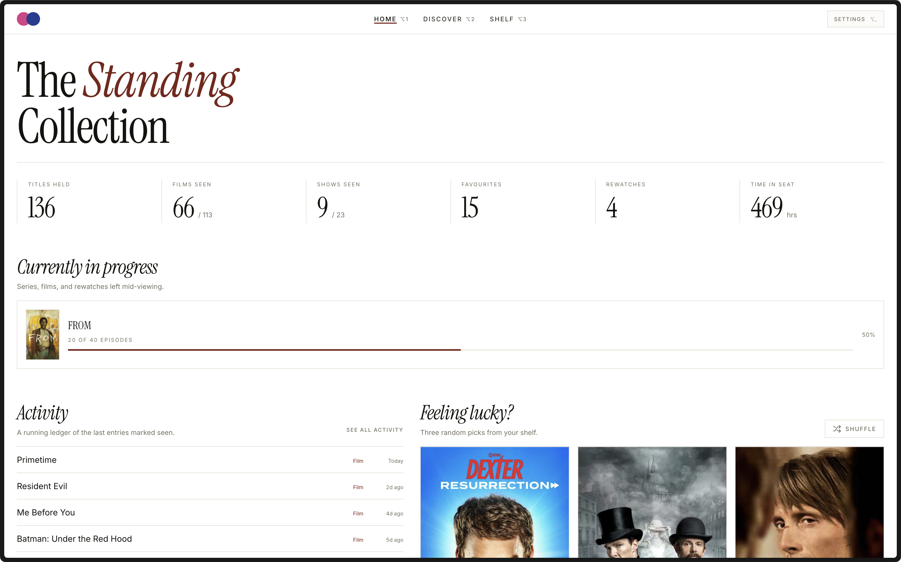
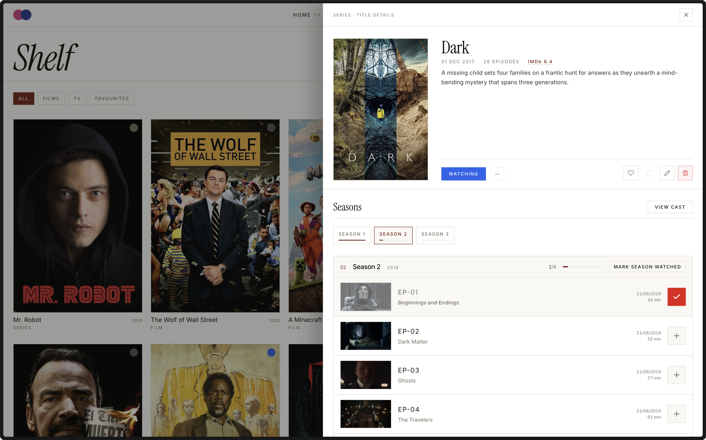

# CineTrack

CineTrack is a personal home for everything you watch. Track films and TV shows, log episodes, and look back on your viewing history whenever you like. It is built as a quiet alternative to busy social trackers — more like a personal cinema ledger. There are no accounts, no feeds, and no noise — everything stays on your own device.



## What it does

- **Build your shelf.** Mark titles as Planned, Watching, Watched, or Dropped.
- **Track TV properly.** Tick off single episodes or whole seasons, and follow rewatches separately.
- **Make it personal.** Add ratings, favourites, notes, watch dates, and even your own poster images.
- **Discover new things.** Search TMDb, browse what's trending, and get "For You" picks based on your shelf.
- **See your habits.** The home dashboard shows monthly charts, hours watched, and title counts.
- **Make it yours.** Pick from light and dark themes, tweak colours, and adjust the layout.
- **Stay portable.** Export your shelf to a JSON file, or import one, from Settings.



## How it works

CineTrack is a local web app. Your shelf lives in a small SQLite database inside the project folder (`data/database.sqlite`), not on a remote server. Title information and artwork come from The Movie Database (TMDb), fetched through a local proxy so your API key never reaches the browser.

Your records are also portable: Settings can export the whole shelf to a JSON file and restore it later, which doubles as an easy backup.

## Built with

React 19, TypeScript, Vite, Tailwind CSS, and sql.js for the local database, with metadata and posters from TMDb.

## Getting started

You need two things: Node.js 22.12 or newer, and a free [TMDb API key](https://www.themoviedb.org/).

1. Install the dependencies:

   ```bash
   npm install
   ```

2. Create a `.env` file in the project root with your key:

   ```env
   TMDB_KEY=your_api_key_here
   ```

3. Start the app:

   ```bash
   npm run dev
   ```

Then open the address shown in your terminal, usually <http://127.0.0.1:8443>. The server runs only on your own machine, so nothing is shared. To try a production build instead, run `npm run build` followed by `npm run start`.

## Development

- `npm test` runs the test suite.
- `npm run verify` runs the type check, tests, and a build in one pass.
- Want an isolated database? Set `CINETRACK_DATA_DIR` to a different folder.

## Acknowledgements

This product uses the TMDb API but is not endorsed or certified by TMDb in any way.